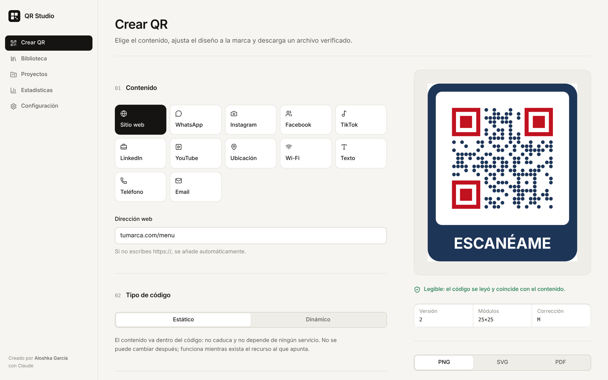
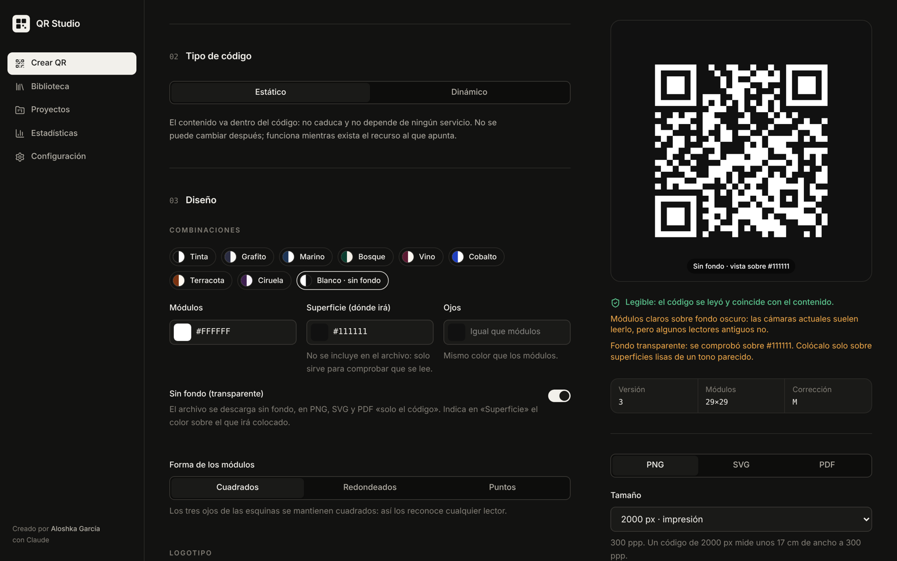

# QR Studio

**Crea códigos QR profesionales con el estilo de tu marca.** Colores, logotipo, marcos y
descargas en PNG, SVG y PDF listas para imprimir. Cada archivo se comprueba automáticamente antes
de descargarlo, para que siempre se pueda leer.



---

## ⬇️ Descargar

### [⬇️ Descargar QR Studio para Windows](https://github.com/aloshkagarcia-designer/QR-Studio-Download/releases/latest/download/QR-Studio-Windows.zip)

Al hacer clic, la descarga empieza sola: es la **última versión**. Si quieres ver las novedades o
versiones anteriores, entra en [todas las versiones](https://github.com/aloshkagarcia-designer/QR-Studio-Download/releases).

| | |
|---|---|
| **Sistema** | Windows 10 u 11 (64 bits) |
| **Espacio** | unos 120 MB |
| **Necesitas** | un navegador (Edge, Chrome, Firefox…). Ya viene en Windows. |
| **Internet** | no hace falta para crear y descargar tus códigos |
| **Precio** | gratis |

> **¿Mac, iPhone o iPad?** Por ahora QR Studio funciona solo en **Windows**. Mira las
> [preguntas frecuentes](#preguntas-frecuentes).

---

## Instalar (una sola vez, unos 2 minutos)

No hay que instalar nada más: todo lo necesario va dentro del archivo.

1. **Descarga** el archivo `QR-Studio-Windows.zip` (enlace de arriba). Normalmente se guarda en
   la carpeta **Descargas**.
2. **Evita el aviso de Windows:** haz **clic derecho** sobre el archivo descargado → **Propiedades**
   → abajo, marca la casilla **Desbloquear** → **Aceptar**.
3. **Descomprime:** clic derecho sobre el archivo → **Extraer todo…** → **Extraer**.
4. Se abre una carpeta con esto:

   ```
   📁 _internal        ← no la toques: QR Studio la necesita
   📄 LEEME            ← estas mismas instrucciones, en corto
   🔲 QR Studio        ← el programa
   ```

5. **Doble clic en `QR Studio`.** Se abre una ventana negra y, en unos segundos, tu navegador con
   la aplicación.

> 💡 **Consejo:** para tenerlo a mano, haz clic derecho sobre `QR Studio` → **Mostrar más
> opciones** → **Enviar a** → **Escritorio (crear acceso directo)**.

### Si aparece «Windows protegió su PC»

Es normal en programas que no se venden en una tienda. Haz clic en **Más información** y después
en **Ejecutar de todas formas**. Solo ocurre la primera vez.

---

## Usar

| Para… | Haz esto |
|---|---|
| **Abrir** QR Studio | Doble clic en `QR Studio` (o en tu acceso directo). |
| **Cerrar** QR Studio | Cierra la **ventana negra**. |
| **Crear un código** | En **Crear QR**: elige el tipo (web, WhatsApp, Instagram, Wi-Fi…), escribe los datos y ajusta el diseño. |
| **Descargar** | Elige **PNG**, **SVG** o **PDF** y pulsa **Descargar**. Si el diseño no se pudiera leer, QR Studio no deja descargarlo y te dice qué cambiar. |
| **Guardar y organizar** | Ponle nombre y proyecto y pulsa **Guardar en biblioteca**. Lo encontrarás en **Biblioteca**. |
| **Copia de seguridad** | **Configuración → Descargar copia.** Guárdala en un disco externo o en tu nube. |


### Qué puedes crear

- **Enlaces:** sitio web, WhatsApp con mensaje, Instagram, Facebook, TikTok, LinkedIn, YouTube y
  ubicación en el mapa.
- **Otros:** red Wi-Fi, texto, teléfono y email.
- **Diseño:** colores de tu marca, módulos cuadrados, redondeados o en puntos, logotipo, marco con
  texto («Escanéame») y versión **blanca sin fondo** para fondos oscuros.



---

## Actualizar a una versión nueva

1. Cierra QR Studio (la ventana negra).
2. Descarga la versión nueva desde el enlace de arriba y repite los pasos 2 y 3 de la instalación.
3. Borra la carpeta de la versión anterior y abre la nueva.

**No pierdes nada:** tus códigos, proyectos y logotipos se guardan aparte y la versión nueva los
encuentra sola.

---

## Preguntas frecuentes

**¿Mis datos se envían a internet?**
No. Todo se guarda solo en tu computadora, en la carpeta `%LOCALAPPDATA%\QR Studio`. QR Studio no
tiene cuentas, publicidad ni seguimiento.

**¿Los códigos caducan?**
Los códigos **estáticos** (los normales) no caducan nunca: funcionan mientras exista la página o el
dato al que apuntan.

**¿Puedo imprimir los QR «dinámicos»?**
Todavía no. Los QR dinámicos (los que permiten cambiar el destino sin reimprimir) por ahora solo
funcionan en tu propia computadora. La aplicación te lo avisa. Los estáticos sí están listos para
imprimir.

**El antivirus bloquea el programa.**
Es habitual con programas nuevos que no están firmados por una empresa. Puedes permitirlo en tu
antivirus.

**¿Funciona en Mac?**
Todavía no. Está previsto.

**¿Funciona en iPhone o iPad?**
No. iPhone y iPad solo permiten instalar aplicaciones desde la App Store. Para crear tus códigos
usa una computadora con Windows; los códigos que crees se pueden escanear con cualquier teléfono.

**La ventana dice que otro programa usa el puerto.**
Reinicia la computadora y abre QR Studio de nuevo.

**El navegador no se abrió solo.**
Abre tu navegador y escribe `127.0.0.1:8765` en la barra de direcciones.

---

## Créditos

**Diseño y dirección:** Aloshka García · **Desarrollo:** Claude (Anthropic)

© 2026 Aloshka García. Uso gratuito. Todos los derechos reservados.
